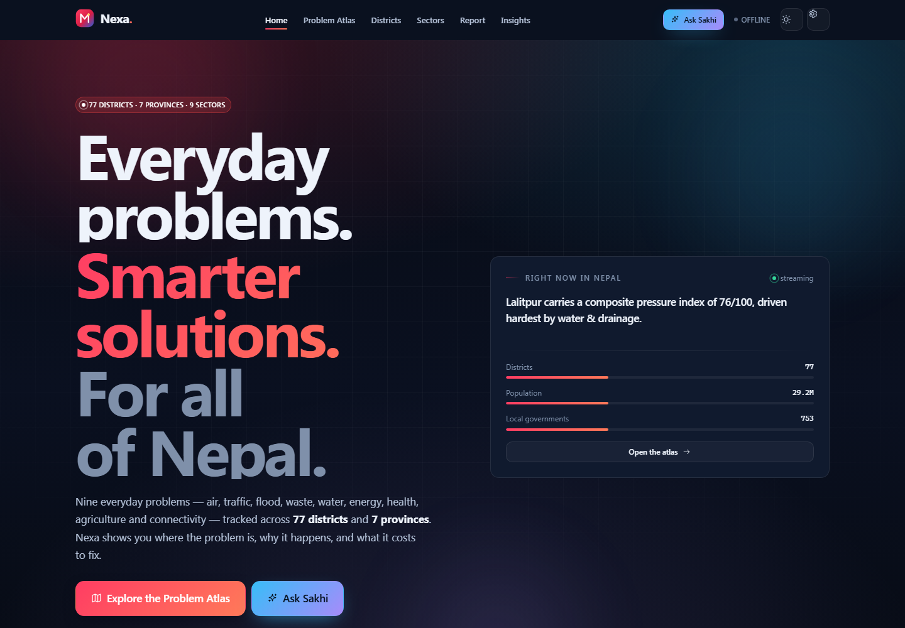
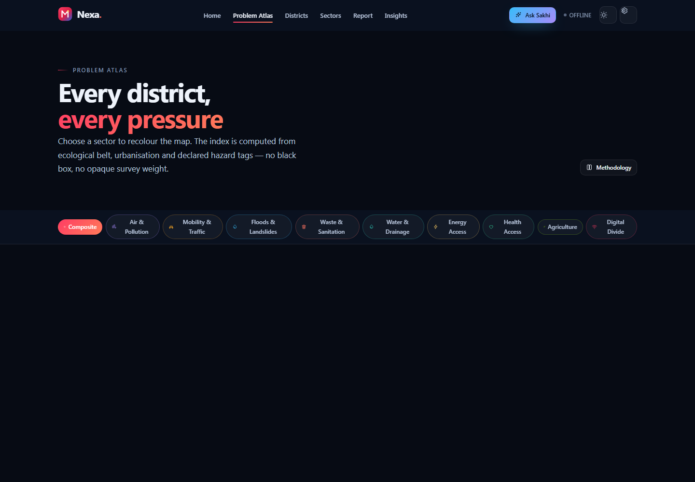
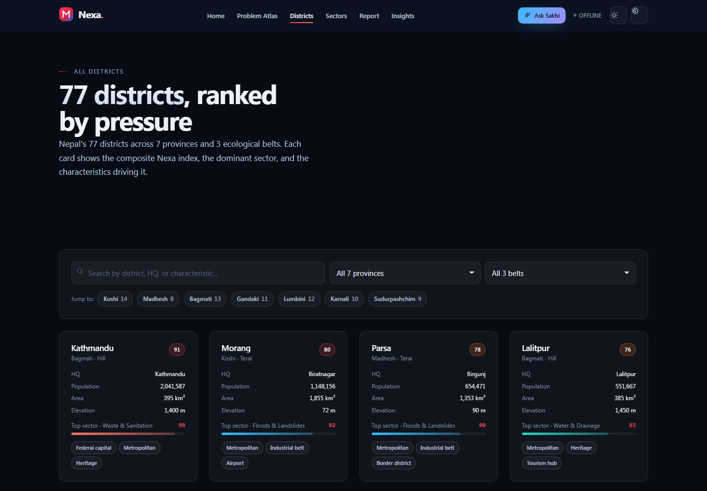
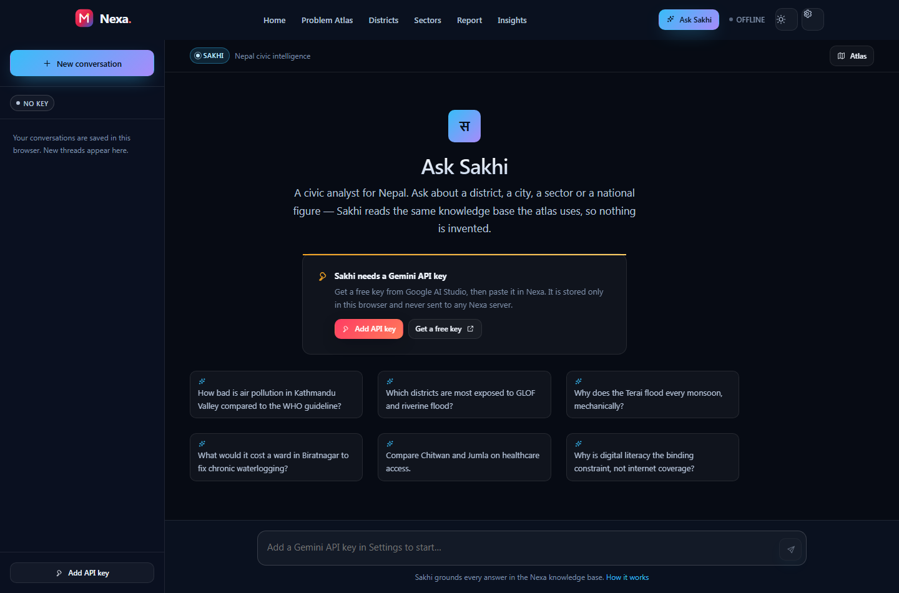
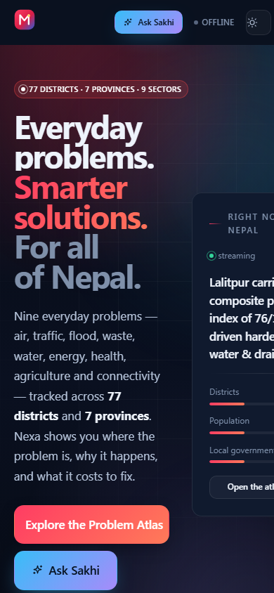
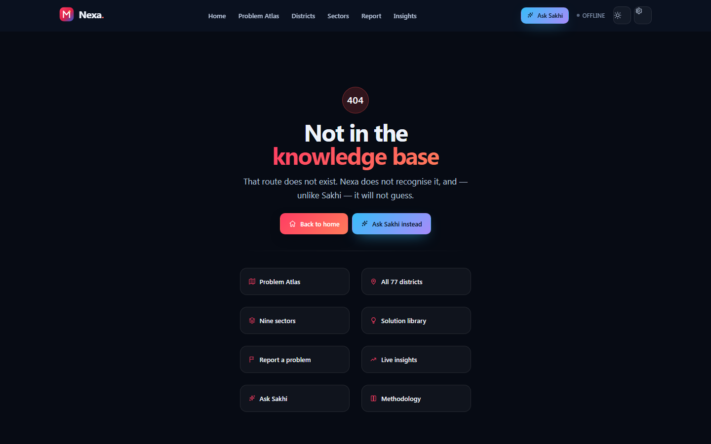

# Nexa — Everyday Problems, Smarter Solutions

**An AI civic-intelligence platform built for Nepal.**

Nexa maps everyday problems — floods, air quality, waste, grid reliability, health access,
agriculture, education, jobs, digital inclusion — across all **77 districts** and **7 provinces**,
then turns that research into local, actionable help: a browsable problem atlas, a citizen
reporting channel, and **Sakhi**, a Nepali-first AI assistant grounded in the same dataset.

> Data note: figures are **indices and modelled indicators** built for orientation, not official
> statistics. Citizen reports are **unverified**. Nothing here is an emergency service.

## Preview

| | |
|---|---|
|  **Home** |  **Problem Atlas** |
|  **District browser** |  **Ask Sakhi** |
| <sub>Mobile</sub>  | <sub>Unknown route</sub>  |

---

## Quick start

```bash
npm install
npm run dev          # static site → http://localhost:5173
```

The site is fully functional with no backend, no account, and no network.

### With the optional API (Gemini key held server-side)

```bash
cp .env.example .env    # then paste GEMINI_API_KEY into .env
npm run dev:full        # API on :8787 + Vite on :5173
```

| Script | What it does |
| --- | --- |
| `npm run dev` | Vite dev server only |
| `npm run server` | Nexa API only (`node server/index.js`) |
| `npm run dev:full` | Both, with prefixed logs |
| `npm run build` | Typecheck + production build to `dist/` |
| `npm run preview` | Serve the production build locally |
| `npm run typecheck` | `tsc -b --force` |
| `npm run lint` | oxlint over `src`, `server`, `scripts` |
| `npm run icons` | Regenerate PNG brand assets (no image deps) |
| `npm run zip` | Build `Nexa.zip` (fails above 100 files) |

---

## How the AI works

Sakhi runs over one of two transports, chosen automatically at runtime:

1. **Server transport** — `POST /api/ai/stream`. The key stays in `GEMINI_API_KEY` on the
   server. Responses stream back as SSE and pass straight through to the browser.
2. **Browser transport** — the app calls `generativelanguage.googleapis.com` directly with a
   key the user pasted in **Settings**. The key is stored in that browser's `localStorage` and is
   never sent to the Nexa server.

Model IDs are **discovered at runtime** via `GET /v1beta/models`, ranked by capability family,
and retried down a fallback chain. No model name is hard-coded, so the app keeps working when
Google ships a new generation.

Sakhi can call four functions against the local knowledge base — `get_district`,
`list_districts`, `get_sector`, `national_overview` — so answers cite your district's own
numbers rather than generic text.

Get a key at <https://aistudio.google.com/apikey>.

---

## Architecture

```
Nexa/
├─ index.html              app shell, theme boot, no-flash loader
├─ vite.config.ts          @ alias, /api proxy, chunk splitting, 404 fallback
├─ scripts/
│  ├─ gen-icons.mjs        dependency-free PNG encoder for brand assets
│  ├─ dev-full.mjs         runs API + web together
│  └─ make-zip.mjs         portable zip writer, enforces the 100-file budget
├─ server/index.js         optional Express API: Gemini proxy + JSON signal store
├─ data/signals.json       created at runtime, git-ignored
├─ public/                 manifest, icons, OG image, robots, sitemap, .nojekyll
└─ src/
   ├─ App.tsx              router + shell
   ├─ main.tsx             React root
   ├─ data/                77 districts, cities, 9 sectors, national, GeoJSON outline
   ├─ types/               shared domain types
   ├─ lib/
   │  ├─ nepal.ts           lookups, ranking, tag labels, severity model
   │  ├─ db.ts             localStorage: settings, signals, threads, keys, sync
   │  ├─ ai.ts             Gemini discovery, ranking, SSE, retries, tools, insights
   │  └─ utils.ts          formatting, Nepali numerals, safe Markdown
   ├─ store/AppContext.tsx theme, backend detection, threads, signals, toasts
   ├─ hooks/               reveal, count-up, media, pointer, ticker, reduced motion
   ├─ styles/              tokens, base, animations, components
   ├─ components/          icons, logo, UI primitives, nav/footer, Nepal map
   └─ pages/               Home, Atlas, Districts(+detail), Sectors(+detail),
                           Solutions, Report, Insights, Ask, Settings, About, 404
```

### State and privacy

- **No accounts, no tracking, no cookies.** Settings, chat threads, and reports live in
  `localStorage` under the `nexa.*` namespace.
- Reports are stored locally first and only leave the device if you run the optional API
  yourself and explicitly sync.
- A browser API key never reaches the Nexa server. Clearing site data removes everything.

### Design system

Dark-first, light-complete, with a Nepal-derived palette: crimson, deep blue, saffron, glacier
cyan. Fluid `clamp()` type, 44px touch targets, visible focus rings, `prefers-reduced-motion`
honoured, keyboard-navigable throughout, and bilingual EN/नेपाली foundations.

---

## Deploying

### GitHub Pages

The included `.github/workflows/pages.yml` builds and deploys on every push to `main`.

1. Push this folder to a repository.
2. **Settings → Pages → Source → GitHub Actions**.
3. For a project site at `https://<user>.github.io/<repo>/`, set `base: '/<repo>/'` in
   `vite.config.ts`. A user/organisation site needs no change.

The build copies `index.html` to `404.html` and `200.html`, because GitHub Pages has no rewrite
rules — this is what makes deep links like `/districts/bhaktapur` work on a hard refresh.

### Any static host

`npm run build` emits a fully self-contained `dist/`. Serve it from the domain root.

### Self-hosting the API

```bash
GEMINI_API_KEY=... PORT=8787 node server/index.js
```

Put it behind TLS and a reverse proxy. Endpoints:

| Method | Route | Purpose |
| --- | --- | --- |
| `GET` | `/api/health` | Liveness, key presence, discovered models |
| `POST` | `/api/ai/stream` | SSE Gemini proxy with model fallback chain |
| `GET` | `/api/signals` | Stored civic signals (90-day window) |
| `POST` | `/api/signals` | Upsert one signal or `{ signals: [...] }` |
| `DELETE` | `/api/signals/:id` | Remove a signal |

Input is length-capped and shape-validated server-side; writes are serialised to avoid file
corruption; the store is capped at 5,000 records.

---

## Data and methodology

- 77 districts and 7 provinces, each with socio-economic, infrastructure, hazard, and
  environment indicators.
- 9 sectors, each with definitions, measurable indicators, and a solution library.
- National aggregates, time series, monsoon/landslide risk, and verified emergency numbers.
- Every series carries a `source` label. Sources are listed in **/about**.

Indicators are normalised 0–100 where a higher number means more attention needed. If you are
making a funding or policy decision, follow the cited primary source.

---

## Accessibility & browser support

Semantic landmarks, a skip link, `aria-live` for AI and toast updates, focus management in
dialogs, keyboard-operable map and tabs, `prefers-reduced-motion`, and 4.5:1 text contrast in
both themes. Modern evergreen browsers; no polyfills required.

## Licence

MIT for the code. The underlying public statistics belong to their original publishers — please
keep source attribution intact.